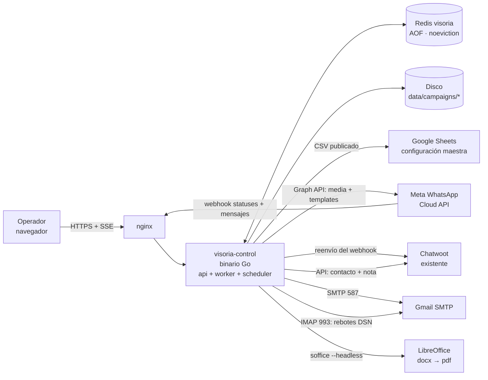
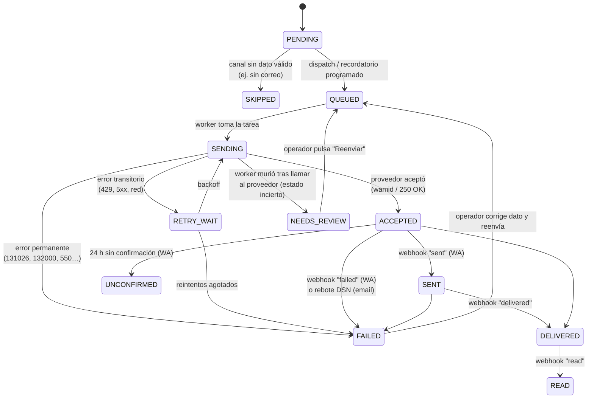
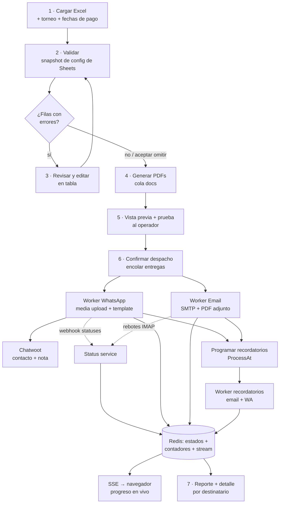
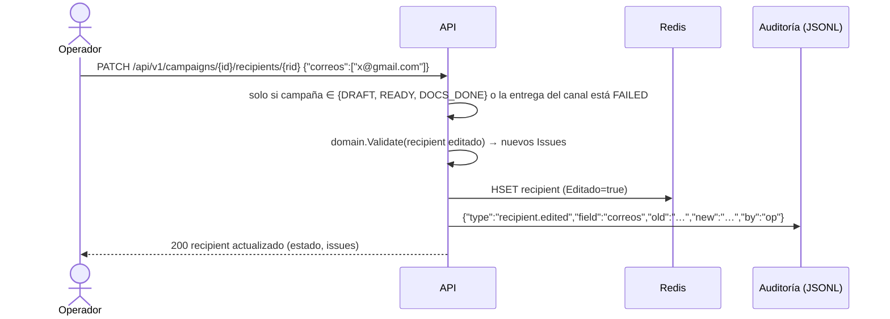
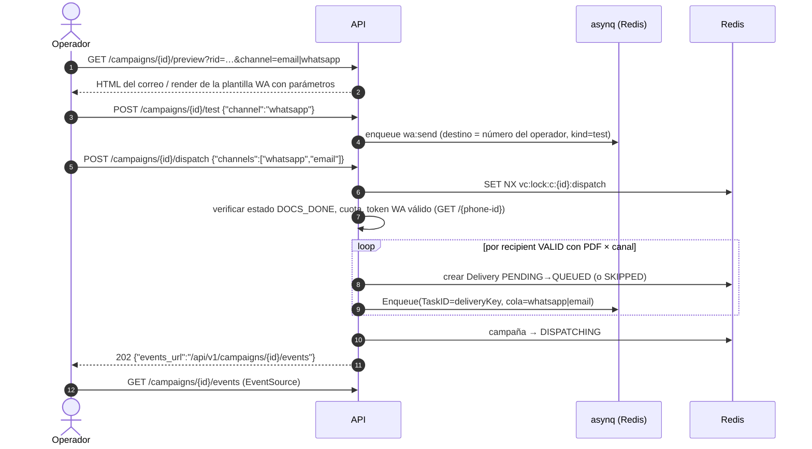
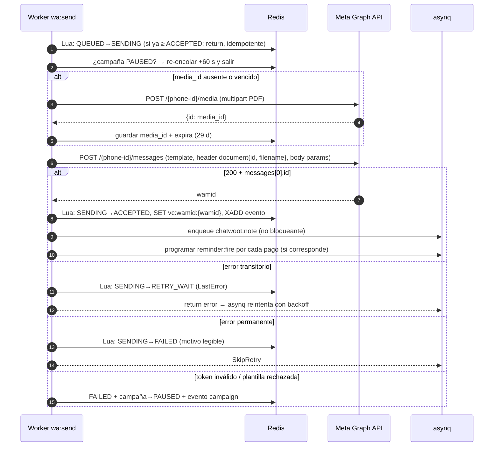

# SDD — Visoria Control v2

**Plataforma unificada de propuestas de beca: WhatsApp + Correo + Recordatorios de pago, con trazabilidad real de entrega**

| | |
|---|---|
| Versión | 1.1 (D1–D4 resueltas, listo para revisión final) |
| Fecha | 2026-11-03 |
| Proyectos analizados | `visoria_control` (Go) · `MajesticBecas` (Python/Flask, desarrollado por el cliente) |
| Restricciones del cliente | Servidor económico · sin base de datos relacional · configuración maestra en Google Drive (Sheets) · Redis permitido |

---

## Índice

1. [Visión general del sistema y objetivos](#1-visión-general-del-sistema-y-objetivos)
2. [Diagnóstico de problemas actuales y malas prácticas](#2-diagnóstico-de-problemas-actuales-y-malas-prácticas)
3. [Arquitectura propuesta](#3-arquitectura-propuesta)
4. [Diseño del flujo de datos](#4-diseño-del-flujo-de-datos)
5. [Plan de acción y refactorización paso a paso](#5-plan-de-acción-y-refactorización-paso-a-paso)
6. [Anexos: decisiones abiertas, glosario de estados, riesgos](#6-anexos)

---

## 1. Visión general del sistema y objetivos

### 1.1 Contexto

Majestic Intercambio Deportivo becó a jugadores en visorias o torneos. A cada acudiente se le envía una **propuesta económica en PDF**, con su beca, su tabla de costos y su plan de pagos. Más adelante se le envían **recordatorios** antes de cada fecha de pago.

Hoy existen dos sistemas separados:

| | `visoria_control` (Go, servidor) | `MajesticBecas` (Python, PC del cliente) |
|---|---|---|
| Entrada | Excel con columnas en **posición fija** | Excel con **detección de encabezados por alias** |
| Configuración | CSV de Google Sheets (URL fija en el frontend) | `config.json` local, editado en la pantalla de configuración |
| PDF | `gofpdf`, diseño dibujado en código | **Plantillas Word (.docx)** que el cliente edita, convertidas con Word o LibreOffice |
| Canal | WhatsApp (Meta Cloud API) + copia en Chatwoot | Correo (Gmail SMTP) con botón `wa.me` |
| Recordatorios | No existen | Sí, pero **solo si el PC está encendido y el programa abierto** |
| Registro de envíos | Ninguno (canal en memoria) | `ENVIOS.json` / `RECORDATORIOS.json` por generación |
| Progreso | Stream de texto por POST; el frontend busca palabras para detectar errores | Polling cada 800 ms a un diccionario `JOBS` en memoria |
| Qué cuenta como "enviado" | HTTP 200 de Meta | El servidor SMTP aceptó el correo |

### 1.2 El problema de confianza

Los dos sistemas consideran **"enviado" un mensaje que el proveedor solo aceptó**:

- Meta responde **200 + `wamid`** apenas recibe la petición. La entrega real, o el fallo (número sin WhatsApp, PDF que no se pudo descargar, plantilla mal parametrizada, límite de calidad), llega **después, por webhook**. `visoria_control` no tiene ese webhook.
- Gmail responde **250 OK** al aceptar el correo. Si la dirección no existe, el rebote llega minutos después como un correo de *mailer-daemon* a la bandeja, y nadie lo procesa. El propio `LEEME.md` del cliente lo reconoce: *"Gmail lo envía y luego te llega a tu bandeja un aviso de «no entregado»: corrige ese correo y envíale el PDF a mano."*

Por eso la pantalla decía "todo enviado" mientras algunos acudientes nunca recibían nada.

### 1.3 Objetivos

| # | Objetivo | Métrica de aceptación |
|---|---|---|
| O1 | **Estado honesto por destinatario y canal**: distinguir *aceptado por el proveedor* de *entregado*, *leído* y *fallido (con motivo)*. | 100 % de los envíos de WhatsApp terminan en `DELIVERED`/`READ`/`FAILED` (estado confirmado por webhook) o, después de 24 h, en `SIN_CONFIRMACION`, visible en pantalla. Los rebotes de correo aparecen en menos de 15 min. |
| O2 | **Un solo sistema** que envía **WhatsApp y correo** desde los mismos datos, con las validaciones y las plantillas Word del cliente. | Se retira la app Python sin perder funcionalidades (ver la matriz de §3.9). |
| O3 | **Procesamiento asíncrono durable**: cerrar el navegador, perder la conexión o reiniciar el servidor no detiene ni duplica una campaña. | Prueba de caos: matar el proceso a mitad de una campaña de 200 destinatarios → al reiniciar continúa sin duplicados. |
| O4 | **Progreso en tiempo real**, con reconexión y contadores correctos. | La barra refleja `procesados/total` reales. Al recargar la página se recupera el estado exacto. |
| O5 | **Edición antes de enviar**: ver en el navegador las filas con datos faltantes o inválidos, corregirlas y revalidarlas sin volver a subir el Excel. | Una fila con el correo vacío se corrige en la tabla y queda `VÁLIDA` sin recargar. |
| O6 | **Recordatorios automáticos en el servidor**, por correo y WhatsApp, sin depender de un PC encendido. | Los recordatorios salen a la hora programada (America/Bogota) con el servidor como único requisito. |
| O7 | **Costo mínimo de infraestructura.** | Funciona en un VPS de 2 vCPU / 2 GB de RAM junto al Chatwoot existente. Sin base de datos relacional nueva. |
| O8 | **Seguridad básica**: secretos fuera del repositorio, PDFs con datos de menores no públicos, autenticación. | Checklist de §5, Fase 0, cumplido. |

### 1.4 Fuera de alcance (por ahora)

- Seguimiento de respuestas y conciliación de pagos. El cliente lo dejó como *"pendiente para la siguiente fase"*.
- Multi-tenant o multi-organización.
- Base de datos relacional. Si el volumen crece más de 10 veces, se reevalúa (§6.3).

---

## 2. Diagnóstico de problemas actuales y malas prácticas

Severidad: 🔴 crítica (pérdida de mensajes, datos o seguridad) · 🟠 alta · 🟡 media.

### 2.1 `visoria_control` (Go)

#### A. Confiabilidad del envío y del progreso

| Sev. | Hallazgo | Ubicación | Impacto |
|---|---|---|---|
| 🔴 | **"Enviado" = HTTP 200 de Meta.** Se descarta el `wamid` de la respuesta y no hay webhook de estados. | `internal/adapters/external/whatsapp_api.go:65-72` | No hay forma de saber si el mensaje llegó. **Es la causa raíz del problema de confianza.** |
| 🔴 | **Cerrar la pestaña congela la campaña.** `progressChan` no tiene buffer. Si el navegador se desconecta, `c.Stream` deja de leer y la goroutine se bloquea para siempre en `progressChan <- msg`. El envío se detiene en un punto arbitrario, sin registro de hasta dónde llegó. | `internal/adapters/handlers/visoria_handler.go:104-123`, `internal/core/services/visoria_service.go:170` | Campañas a medias y fuga de goroutines. Al reenviar, se duplica a quienes ya recibieron. |
| 🔴 | **Se envía WhatsApp aunque el PDF no se haya generado.** `GenerateDocuments` registra el error en consola y continúa. `DispatchWhatsAppMessages` arma la URL del PDF de forma independiente y envía igual. Meta acepta (200) y luego falla al descargar el documento, y ese fallo solo llega por webhook. | `visoria_service.go:145-149`, `:180` | Precisamente el caso "respondió 200 pero no le llegó". |
| 🔴 | **Ningún estado persistido.** Todo vive en `window.currentPlayers` y en un canal en memoria. No hay forma de reanudar, reintentar solo los fallidos ni consultar el historial. | Todo el flujo | Reiniciar el servidor = perder la campaña. |
| 🟠 | **Ejecución síncrona dentro de la petición HTTP**, con `context.Background()` y `time.Sleep(6s)` por destinatario. 100 destinatarios ≈ 10 min de conexión abierta, expuesta a timeouts del proxy. | `visoria_handler.go:110`, `visoria_service.go:206,227` | Cortes por timeout de nginx o Cloudflare. No se puede cancelar. |
| 🟠 | **El frontend deduce el estado del texto.** Busca `"Error"` o `"rechazó"` en el mensaje. Cuenta *cada* mensaje como progreso, y hay 2 por destinatario ("Enviando…" + resultado), así que la barra llega al 100 % a la mitad. Al final siempre muestra *"¡Todos … enviados exitosamente!"*. | `frontend/js/app.js:204-219` | El usuario ve un éxito falso. |
| 🟠 | **Los fallos de Chatwoot se ocultan.** Solo se imprimen en la consola del servidor. | `visoria_service.go:220-224` | El equipo de soporte no ve la conversación y nadie lo sabe. |
| 🟠 | **Posible doble envío por Chatwoot (verificar).** Se crea un mensaje `outgoing`, `private:false`, en el inbox `CHATWOOT_INBOX_ID=2`. Si ese inbox es de tipo **WhatsApp Cloud**, Chatwoot **intenta enviarlo de verdad** como texto libre: falla fuera de la ventana de 24 h o duplica el mensaje dentro de ella. | `visoria_service.go:403-409` | Mensajes fallidos o duplicados en Chatwoot. Ver la decisión D7. |
| 🟡 | **No hay reintentos ni clasificación de errores.** Un 429/5xx transitorio de Meta se trata igual que "número inexistente" (131026) o "token vencido" (190/401). | `whatsapp_api.go` | Fallos recuperables que quedan como definitivos. Si el token vence, *todos* fallan uno por uno. |

#### B. Datos y validación

| Sev. | Hallazgo | Ubicación | Impacto |
|---|---|---|---|
| 🔴 | **El cliente es la fuente de verdad.** El navegador envía el arreglo completo de jugadores (incluidos `Status`, precios y `FileID`) a `/documents/generate` y a `/messages/send`, y el servidor lo acepta sin revalidar. | `visoria_handler.go:67-97` | Cualquiera puede marcar como `PENDING` una fila inválida o cambiar precios y teléfonos. |
| 🟠 | **Columnas por posición fija** (`getCol(0..5)`), solo la primera hoja, filas con menos de 4 columnas descartadas en silencio. **No lee el correo.** El Excel real del cliente tiene otro orden (`NOMBRE, CLUB, BECA, ACUDIENTE, …, CORREO`). | `visoria_service.go:48-111` | Datos cruzados (teléfono en lugar de acudiente) sin ningún aviso. |
| 🟠 | **Errores ignorados**: `GetTournamentForPlayer` (`torneoInfo, _ :=`), `strconv.Atoi` en rangos, decodificación de JSON de Chatwoot. | `visoria_service.go:92`, `csv_repository.go:137-138` | Valores en cero tratados como válidos. |
| 🟡 | **Reglas de beca distintas a las del cliente.** Acepta cualquier texto y le agrega `%`. El cliente solo admite 30/50/70/100/sin beca y omite "sin beca". | `visoria_service.go:71-75` | Propuestas con becas que no existen. |
| 🟡 | **Repositorio de configuración global y sin mutex.** `LoadConfigFromCSV` reemplaza los mapas mientras otra petición los lee. | `csv_repository.go:44-47` | *Data race* (detectable con `go test -race`). |

#### C. Arquitectura y código

| Sev. | Hallazgo | Ubicación |
|---|---|---|
| 🟠 | **Infraestructura dentro del servicio de negocio**: unas 200 líneas de HTTP a Chatwoot y lecturas de `os.Getenv` dentro de `services`. Rompe la arquitectura hexagonal que el proyecto declara. Mientras tanto, `adapters/chatwoot/chatwoot.go` existe pero **nadie lo usa**. | `visoria_service.go:233-430` |
| 🟠 | **Nombre del PDF calculado en dos lugares** (generador y servicio), que deben coincidir carácter por carácter. | `pdf_generator.go:31`, `visoria_service.go:180` |
| 🟡 | Plantilla `purchase_receipt_3`, idioma, URL base, indicativo `57` y pausa de 6 s **fijos en el código**. | `visoria_service.go` |
| 🟡 | Se crea un `http.Client` nuevo por llamada, uno de ellos **sin timeout** (Meta). `http.Get` sin contexto en el repositorio. | `whatsapp_api.go:58`, `csv_repository.go:29` |
| 🟡 | Middleware que inyecta un `ctx` que nadie usa. No hay *graceful shutdown*. No hay logs estructurados (`fmt.Printf` con emojis). No hay **ningún test**. | `cmd/api/init_server.go:33-39` |
| 🟡 | URL del Google Sheet fija en el frontend. `POST /config/load` acepta **cualquier URL** (SSRF). | `frontend/js/app.js:23`, `csv_repository.go:29` |

#### D. Seguridad

| Sev. | Hallazgo |
|---|---|
| 🔴 | **`.env` versionado desde el primer commit** (`WHATSAPP_TOKEN`, `CHATWOOT_API_TOKEN`). No hay `.gitignore`. **Hay que rotar los tokens ya.** |
| 🔴 | **PDFs con datos de menores públicos** en `/pdfs/*` (nombre, acudiente, teléfono, correo) y unos 50 de ellos versionados en `uploads/pdfs/`. |
| 🟠 | **Sin autenticación**: cualquiera con la URL puede lanzar una campaña masiva. CORS con `"*"` y `AllowCredentials: true`. |
| 🟡 | La carpeta `MajesticBecas (2)/` y el `.zip` están en el directorio del repo **sin ignorar** y contienen correos reales de acudientes en `salidas/`. |

### 2.2 `MajesticBecas` (Python — app del cliente)

**Lo que está bien y hay que conservar.** El cliente hizo un trabajo de producto muy sólido:

- ✅ **Lectura robusta del Excel**: detecta la fila de encabezados entre las primeras 10, con alias sin tildes ni mayúsculas (`excel_reader.py:194-202, 325-342`).
- ✅ **Validación por fila con errores y advertencias** que indican la fila y la casilla exactas, en español claro. Detecta duplicados (mismo nombre y año). Maneja "sin beca" como omisión, no como error.
- ✅ **Validación de la configuración**: la suma de los pagos debe dar el precio y un año no puede estar en dos plantillas (`config.py:124-161`).
- ✅ **Plantillas Word editables**, validadas al subirlas, con versionado en `plantillas/anteriores` (`app.py:191-239`). Reemplazo de campos `XXXX` aunque Word los parta en varios *runs* (`generador.py:39-61`). Verificación final de que no quede ningún `XXX`.
- ✅ **Idempotencia**: "lo enviado nunca se repite". Si se corta, solo salen los que faltan. Escrituras atómicas (`tmp` + `os.replace`).
- ✅ **Correo de prueba** a la propia cuenta y **vista previa** antes del envío masivo.
- ✅ **Recordatorios con calendario y estados** (`enviado`, `hoy`, `programado`, `sin_propuesta`, `no_aplica`, `vencido`) y reglas finas: nunca el mismo día en que recibió la propuesta y nunca después de la fecha de pago.
- ✅ **Correo HTML compatible con Gmail y Outlook**, con el recuadro "NO respondas" y un botón `wa.me` con mensaje prellenado. Recuadro del video "¿Cómo realizar tu pago?".
- ✅ **Snapshot de parámetros por generación**: las fechas y los valores usados se guardan en la hoja `Parámetros` del reporte, así los recordatorios usan los mismos valores que la propuesta impresa.
- ✅ **Tests** con pytest y un Excel de ejemplo.

**Limitaciones que la nueva arquitectura debe resolver:**

| Sev. | Limitación | Ubicación |
|---|---|---|
| 🔴 | Mismo problema de confianza: un correo se marca `"enviado"` en cuanto Gmail lo acepta. Los rebotes se procesan a mano. | `correo.py:434-451` |
| 🔴 | **Los recordatorios dependen de que el PC esté encendido** y el programa abierto. La solución actual (correos al operador para que abra el programa, con una invitación de calendario) confirma el problema. | `app.py:552-560`, `recordatorios.py:284-419` |
| 🟠 | No envía WhatsApp; solo ofrece un enlace `wa.me` para que el acudiente escriba. | `correo.py:259-265` |
| 🟠 | Límite de Gmail de unos 500 correos al día. Al llegar a él, el envío se **detiene** y alguien debe volver a pulsar "Enviar" otro día. | `correo.py:444-448` |
| 🟠 | Estado en archivos con la **clave = nombre del PDF**. Si alguien renombra un PDF o edita `REPORTE.xlsx`, se pierde la relación. Las fechas de pago se **reconstruyen leyendo texto** (`"€ 500 el 20/11/2026"`) de una celda de Excel. | `correo.py:420`, `recordatorios.py:34-60` |
| 🟡 | `JOBS` en memoria con un solo trabajo global a la vez. Polling cada 800 ms. | `app.py:33, 246-248` |
| 🟡 | La contraseña de Gmail se guarda en el *keyring* de Windows. No es portable a un servidor. | `correo.py:183-198` |
| 🟡 | Conversión a PDF atada a Word o LibreOffice instalado en el PC. | `pdf.py` |
| 🟡 | Solo se clasifica `SMTPRecipientsRefused`. Cualquier otro error detiene todo el lote. | `correo.py:438-448` |

### 2.3 Conclusión del diagnóstico

1. El problema de confianza **no es de la interfaz**. Ningún sistema **modela el ciclo de vida real de un mensaje** (aceptado → entregado → leído o fallido) ni escucha las confirmaciones asíncronas de los proveedores.
2. El cuello de botella arquitectónico es que **el envío vive dentro de la petición HTTP o del proceso del navegador**, sin estado durable.
3. La app del cliente tiene la **mejor lógica de negocio** (validación, plantillas, recordatorios). `visoria_control` tiene la **mejor ubicación** (servidor 24/7, WhatsApp, Chatwoot). La v2 combina las dos en Go.

---

## 3. Arquitectura propuesta

### 3.1 Principios

1. **El servidor es la fuente de verdad.** El navegador solo envía el Excel, las ediciones y las órdenes. Nunca envía datos ya validados.
2. **Toda petición HTTP responde en menos de 1 s.** El trabajo pesado (PDF, envíos) va a una **cola durable en Redis** y lo procesan **workers**.
3. **Modelo de estados explícito** por *entrega* (destinatario × canal × tipo de mensaje). Solo avanza hacia adelante y es idempotente.
4. **Las confirmaciones de los proveedores entran por webhooks o sondeo** y actualizan el mismo modelo.
5. **El progreso es una proyección de los estados**, no texto. Se transmite por **SSE** con reconexión.
6. **Sin base de datos relacional**: Redis (AOF) es el estado operativo, el disco guarda la auditoría y los artefactos, y Google Sheets guarda la configuración.
7. **Un solo binario Go** con roles (`api`, `worker`, `scheduler`) que en el VPS pequeño corren en el mismo proceso.

### 3.2 Vista de contexto



### 3.3 Decisiones arquitectónicas clave (ADR resumidos)

| ADR | Decisión | Alternativas descartadas | Motivo |
|---|---|---|---|
| ADR-1 | **Cola: [`hibiken/asynq`](https://github.com/hibiken/asynq) sobre Redis** | Redis Streams a mano, RabbitMQ, NATS | Reintentos con *backoff*, **tareas programadas** (`ProcessAt`, sirve para los recordatorios), **unicidad por `TaskID`** (idempotencia), colas con prioridad y panel web (`asynqmon`). No agrega infraestructura. |
| ADR-2 | **Progreso por SSE** (`EventSource`) respaldado por **Redis Streams** por campaña | WebSockets | La comunicación es unidireccional. `EventSource` reconecta solo y reenvía `Last-Event-ID`, y con `XRANGE` se reproducen los eventos perdidos. Funciona con nginx sin módulos. |
| ADR-3 | **Estado operativo en Redis + auditoría append-only en disco (JSONL)** | PostgreSQL o SQLite | Es la restricción del cliente. Redis con `appendonly yes` + `noeviction` es durable a ±1 s. El JSONL permite reconstruir el estado y auditarlo con herramientas simples. |
| ADR-4 | **Redis propio** (`redis-visoria`, unos 15 MB de RAM), separado del Redis de Chatwoot | Compartir el Redis de Chatwoot | Chatwoot/Sidekiq puede usar políticas de expulsión o `FLUSHDB` en mantenimiento. Un `allkeys-lru` borraría la cola. El costo de separarlo es casi nulo. |
| ADR-5 | **El PDF va a Meta como *media upload*** (`POST /{phone-id}/media` → `media_id`) y no como URL pública | URL pública o URL firmada | Elimina la exposición pública de los PDFs y el fallo asíncrono "Meta no pudo descargar el documento". El `media_id` dura 30 días; se guarda en caché por documento y se vuelve a subir si venció. |
| ADR-6 | **Webhook de Meta recibido por Go y reenviado a Chatwoot** (*fan-out*) | Enviar las plantillas a través de la API de Chatwoot | Meta admite **una** URL de webhook por app. Go necesita los `statuses` para la trazabilidad y Chatwoot necesita los mensajes entrantes. El reenvío conserva ambos. Enviar las plantillas por Chatwoot limita los headers de documento y nos deja sin el `wamid`. **Confirmado (D1): es el mismo número que el inbox de Chatwoot.** |
| ADR-7 | **Plantillas Word del cliente** rellenadas en Go + **LibreOffice headless** (un worker, lotes de 25) | Seguir dibujando el PDF con `gofpdf` | El cliente edita sus propuestas en Word. Volver a dibujarlas en código rompe esa autonomía. LibreOffice consume unos 300 MB **solo mientras convierte**. **Adoptado (D2)**, con sidecar Python como plan B. |
| ADR-8 | **Configuración maestra en Google Sheets (varias pestañas publicadas como CSV)**, en caché en memoria + Redis, con **snapshot inmutable por campaña** | `config.json` local | Es lo que pidió el cliente. El snapshot garantiza que los recordatorios usen los valores impresos en la propuesta aunque luego cambie la hoja. |
| ADR-9 | **Correo: módulo de envío propio en Go sobre Gmail SMTP + detección de rebotes por IMAP**, detrás de un puerto `EmailSender` | Brevo, Resend o SES con webhooks · **servidor de correo propio (Postfix)** | Costo cero. El volumen (≤ 400/mes en 2–3 días) cabe con holgura en la cuota de Gmail. Un servidor de correo propio en un VPS barato se descarta: IP sin reputación, sin PTR, puerto 25 bloqueado por muchos proveedores y alta probabilidad de spam, justo lo contrario de lo que busca el proyecto. **Confirmado (D4).** |

### 3.4 Estructura de paquetes (Go)

```
cmd/
  visoria/main.go                 # un binario: --roles=api,worker,scheduler (por defecto todos)
internal/
  domain/                         # sin dependencias externas
    campaign.go                   # Campaign, CampaignStatus, ParámetrosCampaña
    recipient.go                  # Recipient, Issue{Field, Level, Message}
    delivery.go                   # Delivery, Channel, Kind, máquina de estados
    config.go                     # MasterConfig (precios, planes, categorías, textos) + Validate()
    validation.go                 # reglas de beca/año/correo/móvil (portadas de excel_reader.py)
  app/                            # casos de uso (lo que hoy es services/)
    import_service.go             # Excel → borrador de campaña validado
    edit_service.go               # editar destinatario + revalidar
    document_service.go           # encola y genera PDFs
    dispatch_service.go           # encola las entregas
    delivery_handler.go           # handlers de tareas: SendWhatsApp, SendEmail, ChatwootNote
    status_service.go             # aplica eventos de proveedor (webhook, IMAP) al modelo
    reminder_service.go           # calcula y programa los recordatorios
    report_service.go             # REPORTE.xlsx bajo demanda
  ports/                          # interfaces que el núcleo necesita
    repositories.go               # CampaignRepo, DeliveryRepo, EventLog, ConfigSource
    providers.go                  # WhatsAppSender, EmailSender, BounceSource, ChatwootClient, DocRenderer
    queue.go                      # TaskQueue
  adapters/
    http/                         # gin: handlers REST, SSE, auth, webhooks
    excel/                        # excelize + detección de encabezados por alias
    sheets/                       # lector de pestañas CSV publicadas
    docx/                         # rellenado de plantillas .docx (XML) + validación de la plantilla
    libreoffice/                  # conversión docx→pdf (proceso hijo, timeout, perfil temporal)
    whatsapp/                     # Meta: media upload, template send, parser de webhook, clasificador de errores
    email/                        # SMTP (net/smtp + STARTTLS), plantillas HTML, poller IMAP de DSN
    chatwoot/                     # cliente único: buscar/crear contacto, conversación, nota
    redisstore/                   # repositorios + scripts Lua de transición atómica
    asynqueue/                    # implementación de TaskQueue
    audit/                        # escritor JSONL por campaña
  platform/
    config/                       # struct Config cargado desde el entorno UNA vez, validado al arrancar
    log/                          # slog JSON
    httpx/                        # http.Client compartido con timeouts
web/                              # frontend estático (vanilla JS), servido con embed.FS
```

Reglas:

- `domain` y `app` **no importan** `gin`, `redis`, `net/http` ni `os`.
- Toda la configuración entra por `platform/config`. Fuera de ese paquete no se llama a `os.Getenv`.
- Cada adaptador tiene un *fake* en memoria para los tests (`adapters/*/fake`).

### 3.5 Modelo de dominio

```go
type Campaign struct {
    ID           string            // ulid
    Torneo       string            // "torneo donde se becó" (como en la app del cliente)
    FechasPago   []civil.Date      // 1er, 2º y 3er pago; cada beca usa las primeras N
    Canales      []Channel         // [whatsapp, email]
    Status       CampaignStatus    // DRAFT → READY → DOCS_RUNNING → DOCS_DONE → DISPATCHING → COMPLETED | PAUSED | CANCELLED
    Config       MasterConfig      // snapshot inmutable de Google Sheets al crear la campaña
    ConfigHash   string
    CreatedBy    string
    CreatedAt    time.Time
}

type Recipient struct {
    ID         string              // ulid estable; NO depende del nombre del PDF
    Fila       int                 // fila original del Excel
    Jugador, Club, Acudiente string
    Beca       BecaKey             // "30"|"50"|"70"|"100"|"sin_beca"
    Anio       int
    Plantilla  string              // cadete_juvenil | infantil | benjamin_alevin
    Correos    []string
    Movil      string              // E.164 sin "+": 57XXXXXXXXXX
    Issues     []Issue             // {Campo, Nivel: error|advertencia|info, Mensaje}
    Estado     RecipientState      // VALID | INVALID | OMITTED
    Editado    bool                // true si se corrigió en pantalla (auditado)
    Documento  *Document           // {Path, SHA256, GeneratedAt, MetaMediaID, MediaExpiresAt}
}

type Delivery struct {
    Key          string            // "{campaign}:{recipient}:{channel}:{kind}"; idempotente
    Channel      Channel           // whatsapp | email
    Kind         Kind              // proposal | reminder_1 | reminder_2 | reminder_3
    Status       DeliveryStatus
    ProviderID   string            // wamid o Message-ID del correo
    Attempts     int
    LastError    *ProviderError    // {Code, Message, Permanent bool, Raw}
    ScheduledFor *time.Time        // recordatorios
    History      []StatusEvent     // {Status, At, Source: worker|webhook|imap|operator, Detail}
}
```

#### 3.5.1 Máquina de estados de una entrega (núcleo de la confianza)



Reglas:

- **Rango monótono**: `ACCEPTED(1) < SENT(2) < DELIVERED(3) < READ(4)`. Un webhook que llega desordenado (por ejemplo, `delivered` antes que `sent`) solo se aplica si sube de rango. `FAILED` es terminal y gana sobre `ACCEPTED`/`SENT`.
- **Correo**: el estado máximo alcanzable es `ACCEPTED`, que se muestra como **"Aceptado por Gmail (sin rebote)"**, o `FAILED` si llega un rebote. **Nunca se muestra "Entregado" para un correo**, porque el protocolo no lo confirma. Ser honestos con esto también genera confianza.
- **At-most-once ante la duda**: antes de llamar al proveedor se registra `SENDING` con marca de tiempo. Si un worker encuentra una entrega en `SENDING` con más de 5 min de antigüedad (proceso caído), **no reenvía**: la pasa a `NEEDS_REVIEW` y la deja visible para que el operador decida. Es mejor pedir una revisión que enviarle dos veces a un acudiente.
- Cada transición se hace con **un script Lua atómico** que: (1) compara el estado actual, (2) escribe el nuevo, (3) ajusta los contadores (`HINCRBY` −1/+1), (4) hace `XADD` al stream de eventos y (5) escribe la línea JSONL de auditoría. La línea de auditoría la escribe Go justo después, porque Lua no toca disco.

#### 3.5.2 Clasificación de errores de Meta (extracto)

| Código Meta | Significado | Clasificación | Acción |
|---|---|---|---|
| 131026 | Mensaje no entregable (el número no tiene WhatsApp, etc.) | Permanente | `FAILED` con el motivo "El número no tiene WhatsApp o no se puede entregar" |
| 131047 / 131051 | Ventana de 24 h / tipo no soportado | Permanente | `FAILED` (no aplica a plantillas; indica un error de diseño) |
| 132000 / 132001 / 132012 | Parámetros o plantilla inexistente o no aprobada | Permanente **de campaña** | `FAILED` + **pausa la campaña** (fallarían todos) |
| 131053 | Error al subir o descargar el media | Transitorio | Reintentar volviendo a subir el media |
| 130429 / 131056 / 80007 | Límite de tasa o de pares | Transitorio | `RETRY_WAIT` con *backoff* exponencial + jitter |
| 190 / HTTP 401 | Token inválido o vencido | **Circuit breaker** | **Pausa la campaña** y alerta: "Token de WhatsApp vencido" |
| 5xx / timeout / red | — | Transitorio | Reintentar (máx. 5) |

Correo: `5.1.1`/`550` (dirección inexistente) = permanente. `4xx`/`421`/desconexión = transitorio. `5.4.5`/"Daily sending quota exceeded" = **cuota**: la tarea se reprograma para el día siguiente a las 08:00 sin contar como fallo y la campaña muestra "En pausa por límite diario de Gmail; continúa mañana".

### 3.6 Almacenamiento sin base de datos

#### 3.6.1 Redis (estado operativo)

Configuración obligatoria: `appendonly yes`, `appendfsync everysec`, `maxmemory-policy noeviction`, `requirepass` y acceso solo desde `127.0.0.1`.

| Clave | Tipo | Contenido |
|---|---|---|
| `vc:campaigns` | ZSET | id → `createdAt` (listado) |
| `vc:c:{id}` | HASH | metadatos + `config` (JSON snapshot) + `status` |
| `vc:c:{id}:r` | HASH | `recipientID` → JSON `Recipient` |
| `vc:c:{id}:d` | HASH | `deliveryKey` → JSON `Delivery` |
| `vc:c:{id}:n` | HASH | contadores: `whatsapp:QUEUED`, `email:FAILED`, … |
| `vc:c:{id}:ev` | STREAM | eventos para SSE (`MAXLEN ~ 20000`) |
| `vc:wamid:{wamid}` | STRING | `deliveryKey` (TTL 60 d): correlación del webhook |
| `vc:msgid:{messageID}` | STRING | `deliveryKey` (TTL 30 d): correlación de rebotes |
| `vc:cfg:current` | STRING | último `MasterConfig` sincronizado + `syncedAt` |
| `vc:quota:gmail:{yyyymmdd}` | STRING | contador diario (TTL 48 h) |
| `vc:lock:c:{id}:dispatch` | STRING | candado de despacho (SET NX PX) |
| `asynq:*` | — | claves internas de la cola |

Volumen estimado: 200 destinatarios × 2 canales × 4 tipos (propuesta + 3 recordatorios) ≈ 1.600 entregas por campaña, con unos 2 KB cada una ≈ 3 MB. **Decenas de campañas caben en menos de 100 MB.** Retención: `EXPIRE` de 30 días después del último pago de la campaña. El histórico permanente queda en disco.

#### 3.6.2 Disco (artefactos + auditoría)

```
data/campaigns/{fecha}_{torneo}_{id}/
  EXCEL_ORIGINAL.xlsx
  campaign.json          # snapshot de campaña + config (para reconstruir)
  events.jsonl           # auditoría append-only: cada transición, edición y acción del operador
  pdf/{recipientID}.pdf  # nombre interno estable; el nombre visible se calcula al adjuntar
  REPORTE.xlsx           # se regenera bajo demanda (no es fuente de verdad)
data/templates/{clave}.docx + anteriores/
```

Respaldo: `rclone` diario de `data/` + `appendonly.aof` hacia el mismo Google Drive del cliente (costo cero).

#### 3.6.3 Google Sheets (configuración maestra)

Un libro con pestañas, cada una **publicada como CSV** (Archivo → Compartir → Publicar en la web), cuyas URLs se configuran en el servidor (variables de entorno, nunca en el frontend):

| Pestaña | Columnas | Equivale a (`config.json` del cliente) |
|---|---|---|
| `Becas` | `clave` (sin_beca, 30, 50, 70, 100, acompanante) · `nombre` · `precio_eur` · `pago_1` · `pago_2` · `pago_3` | `precios` + `planes_pago` |
| `Categorias` | `anio` · `plantilla` (cadete_juvenil, infantil, benjamin_alevin) | `categorias` |
| `Textos` | `clave` · `valor` (correo_asunto, correo_cuerpo, recordatorio_asunto, recordatorio_cuerpo, whatsapp_contacto, mensaje_whatsapp, video_url) | `correo` + `recordatorios` |
| `Parametros` | `clave` · `valor` (dias_antes, hora_envio, wa_template_propuesta, wa_template_recordatorio, aviso_operador) | `recordatorios` |

- **Sincronización**: botón "Sincronizar configuración" + al crear cada campaña. Se descarga, se valida con las reglas de `config.validar()` del cliente (la suma de los pagos = precio, un año en una sola plantilla, los campos `{…}` de los textos existen) y **solo se reemplaza si es válida**. Si no lo es, se muestran los errores en pantalla y se conserva la última válida.
- La contraseña de Gmail, los tokens y los IDs **no** van en la hoja (es pública vía enlace). Van en variables de entorno del servidor.
- Las plantillas `.docx` siguen subiéndose desde la pantalla de configuración, con la misma validación del cliente (`_revisar_plantilla`). Opcionalmente se pueden leer de una carpeta de Drive en una fase posterior.

### 3.7 Workers y colas

| Cola asynq | Concurrencia | Tareas | Límite de tasa |
|---|---|---|---|
| `docs` | **1** | `doc:render` (lote ≤ 25 recipients → docx → 1 llamada a LibreOffice) | — (protege la RAM) |
| `whatsapp` | 4 | `wa:send` | Token bucket de 10 msg/s (muy por debajo del límite de Meta). Además se respeta el **tier de conversaciones/24 h** del número (250/1K…), con alerta al 80 %. |
| `email` | 1 | `email:send` | 1 cada 1,5 s (igual que el cliente) + cuota diaria configurable (por defecto 450 para dejar margen) |
| `side` | 2 | `chatwoot:note`, `meta:forward` (reintento de reenvío del webhook) | — |
| `scheduled` | — | `reminder:fire` programadas con `ProcessAt` | — |
| `periodic` (scheduler) | — | `imap:poll` cada 10 min · `wa:unconfirmed-sweep` cada hora · `cfg:sync` diario · `ops:daily-summary` | — |

- **TaskID = deliveryKey**: asynq rechaza los duplicados, así que pulsar "Enviar" dos veces no duplica nada.
- **Pausar o cancelar campaña**: se marca `PAUSED` en Redis. Cada handler la consulta antes de llamar al proveedor y, si está pausada, re-encola con un retraso sin consumir intentos.
- **Graceful shutdown**: `SIGTERM` → la API deja de aceptar, asynq termina las tareas en curso (timeout de 30 s) y las no iniciadas siguen en Redis.
- **Chatwoot nunca bloquea la entrega**: la nota en Chatwoot es una tarea aparte. Si falla, se reintenta y se muestra un chip "⚠️ Chatwoot" en la fila, pero el estado del WhatsApp no cambia.

### 3.8 Notificación de progreso en tiempo real (SSE)

- `GET /api/v1/campaigns/{id}/events`, con `Content-Type: text/event-stream`.
- Al conectar: si viene `Last-Event-ID`, se reproducen los eventos con `XRANGE vc:c:{id}:ev (lastID +`. Si no viene, se emite primero un evento `snapshot` con los contadores y el estado.
- Luego `XREAD BLOCK 15000` en un bucle. Cada 15 s sin eventos se envía `: ping` para mantener vivos nginx y Cloudflare.
- nginx: `proxy_buffering off; proxy_read_timeout 1h;` + cabecera `X-Accel-Buffering: no`.
- Formato de evento (JSON, **nunca texto libre para interpretar**):

```json
id: 1730668800123-0
event: delivery
data: {"recipient_id":"01J…","jugador":"ATOM JOSE COLMENARES MORA","channel":"whatsapp",
       "kind":"proposal","status":"FAILED","previous":"ACCEPTED",
       "error":{"code":"131026","message":"El número no tiene WhatsApp","permanent":true},
       "counters":{"whatsapp":{"total":180,"QUEUED":40,"ACCEPTED":12,"DELIVERED":101,"READ":20,"FAILED":7},
                   "email":{"total":176,"QUEUED":90,"ACCEPTED":80,"FAILED":6,"SKIPPED":4}}}
```

- Otros tipos: `campaign` (cambio de estado, pausa por cuota o token), `document` (PDF listo o con error), `notice` (avisos al operador).
- **Si se cierra el navegador, no pasa nada**: los workers siguen. Al volver, la pantalla se reconstruye con `GET /campaigns/{id}` + SSE.

### 3.9 Integración de las funcionalidades del cliente

| Funcionalidad en MajesticBecas | En Visoria Control v2 | Mejora |
|---|---|---|
| Lectura de Excel con alias y validación por fila | `adapters/excel` + `domain/validation` (port 1:1, mismos mensajes) | Los tests del cliente se portan como *table tests* con su `DATOS_VISORIAS_ejemplo.xlsx` |
| Tabla "Casillas por revisar" | Tabla de revisión **editable** (§4.3) | Se corrige en pantalla sin volver a subir el archivo |
| Plantillas Word + validación al subirlas + versiones anteriores | `adapters/docx` + `data/templates/anteriores` | Igual, y en el servidor |
| Torneo y fechas de pago una sola vez por generación | `Campaign.Torneo`, `Campaign.FechasPago` | Igual |
| Correo HTML con recuadro "NO respondas" + botón WhatsApp + video | `adapters/email/templates/*.html` (`html/template`) | Igual |
| Correo de prueba y vista previa | `POST /campaigns/{id}/test` para **ambos canales** (correo y WhatsApp al número del operador) | Se agrega la prueba de WhatsApp |
| ENVIOS.json / RECORDATORIOS.json (no repetir) | Deliveries idempotentes en Redis + `events.jsonl` | Clave estable (ID), no el nombre del PDF |
| Recordatorios 2 días antes, con sus reglas finas | `reminder_service` + `asynq.ProcessAt` | **Salen solos desde el servidor**. También por WhatsApp. |
| Avisos al correo personal para "abrir el programa" | Se reemplaza por un **resumen diario** al operador: "hoy salieron N recordatorios, M fallaron" | Ya no hace falta abrir nada |
| REPORTE.xlsx + ZIP | `GET /campaigns/{id}/report.xlsx` y `/pdfs.zip` | Columnas por canal: estado, fecha, motivo |
| Límite de Gmail: se detiene y hay que reintentar a mano | Reprogramación automática para el día siguiente | Sin intervención |
| Rebotes "corrígelo a mano" | Poller IMAP → `FAILED` con el motivo → corregir el correo en pantalla → "Reenviar" | Trazabilidad completa |

**Regla nueva por canal (D3, adoptada).** En la app del cliente, un correo vacío o inválido es *error* y la fila no se genera. Con dos canales se define:

- La fila es **válida si tiene al menos un canal válido** (correo o móvil).
- El canal faltante queda `SKIPPED` y se muestra como **advertencia**: "Sin correo: solo recibirá WhatsApp".
- El operador puede exigir ambos canales por campaña con la opción "Requerir los dos canales".

---

## 4. Diseño del flujo de datos

### 4.1 Vista general



### 4.2 Paso 1–2: carga y validación

```mermaid
sequenceDiagram
    autonumber
    actor Op as Operador
    participant API as API (Go)
    participant CFG as ConfigSource (Sheets)
    participant XL as Excel adapter
    participant RS as Redis
    participant FS as Disco

    Op->>API: POST /api/v1/campaigns (multipart: excel, torneo, fechas[], canales[])
    API->>API: auth, tamaño ≤ 10 MB, extensión .xlsx, fechas en orden
    API->>CFG: Current() (caché; si > 24 h, sincroniza)
    CFG-->>API: MasterConfig válido (+hash)
    API->>XL: Parse(file) → detectar encabezados (primeras 10 filas, alias)
    XL-->>API: filas crudas o ExcelError("faltan columnas: …")
    API->>API: domain.Validate(fila, config) → Issues + Estado por fila<br/>duplicados (nombre+año) · sin_beca → OMITTED<br/>fechas suficientes para las becas presentes
    API->>FS: guardar EXCEL_ORIGINAL.xlsx + campaign.json
    API->>RS: HSET campaña (DRAFT) + recipients
    API-->>Op: 201 {campaign_id, resumen:{validas, con_errores, omitidas, advertencias}, recipients[]}
```

Endpoints:

| Método | Ruta | Respuesta |
|---|---|---|
| `POST` | `/api/v1/campaigns` | 201 + borrador validado |
| `GET` | `/api/v1/campaigns` | lista (ZSET) con contadores |
| `GET` | `/api/v1/campaigns/{id}` | campaña + recipients + deliveries + contadores |
| `POST` | `/api/v1/config/sync` | resultado de validar la hoja (errores o "ok, versión X") |

### 4.3 Paso 3: revisión y edición



UI (tabla de revisión):

- Filtros: `Con errores` · `Con advertencias` · `Omitidas` · `Todas`.
- Las celdas con error aparecen resaltadas con su mensaje (por ejemplo, *"MOVIL «31245» está incompleto"*). Se editan con clic.
- Columnas de canal: ✉️ / 🟢 WhatsApp, con el estado previsto (`Se enviará` / `Sin dato: se omite`).
- Si el documento ya estaba generado, una edición que lo afecte (nombre, beca, año, acudiente) **invalida el PDF** y lo marca para volver a generarlo.

### 4.4 Paso 4: generación de documentos

1. `POST /api/v1/campaigns/{id}/documents` → 202. Encola `doc:render` en lotes de 25 (TaskID = `{id}:docs:{n}`).
2. El worker `docs` (concurrencia 1), por cada recipient `VALID`:
   - Rellena el `.docx` de su plantilla (port de `generador.py`): encabezado (torneo y fecha), datos del jugador, tabla de costos con la fila de la beca en amarillo, tabla de pagos con N columnas y el control final de que no queden `XXX`.
   - Ejecuta `soffice --headless --convert-to pdf` sobre el lote, con `-env:UserInstallation` temporal y un timeout de 10 min.
   - Verifica que cada PDF exista y pese más de 0 bytes, calcula el SHA256 y lo guarda en `Recipient.Documento`.
   - Un recipient sin PDF **no puede tener entregas encoladas**: se muestra el issue "No se pudo generar la propuesta".
3. Cada PDF emite un evento SSE `document` y la barra de "Generando propuestas" avanza.

### 4.5 Pasos 5–6: vista previa, prueba y despacho



### 4.6 Procesamiento en el worker: WhatsApp



### 4.7 Webhook de Meta (confirmación real)

```mermaid
sequenceDiagram
    autonumber
    participant META as Meta
    participant API as /webhooks/whatsapp
    participant RS as Redis
    participant CW as Chatwoot
    META->>API: GET ?hub.mode=subscribe&hub.verify_token=…&hub.challenge=…
    API-->>META: challenge (si el token coincide)
    META->>API: POST (X-Hub-Signature-256)
    API->>API: verificar HMAC-SHA256(app_secret, body) → si falla: 401
    API->>CW: reenviar body + cabeceras al webhook WhatsApp de Chatwoot (timeout 3 s)
    Note over API,CW: si falla → encolar meta:forward (reintentos)<br/>así Chatwoot no pierde mensajes entrantes
    API-->>META: 200 (siempre < 5 s; el procesamiento es posterior)
    loop entry[].changes[].value.statuses[]
        API->>RS: GET vc:wamid:{id} → deliveryKey (si no existe: ignorar; es un mensaje de Chatwoot)
        API->>RS: Lua: transición monótona (sent/delivered/read/failed + errors[0])
        API->>RS: XADD evento → SSE
    end
```

- `statuses[].errors[]` trae `code`, `title` y `error_data.details`, que se traducen a un mensaje en español para el operador. Por ejemplo, `131026` → *"Este número no tiene WhatsApp o no se puede entregar. Verifica el móvil o usa solo correo."*
- **Barrido de no confirmados** (cada hora): entregas WA en `ACCEPTED` con más de 24 h → `UNCONFIRMED` ("Meta aceptó, pero no confirmó la entrega"), visibles y reenviables.

### 4.8 Procesamiento en el worker: correo y rebotes

1. `email:send`: misma secuencia (Lua `QUEUED→SENDING`, chequeo de pausa).
2. Se toma un token de cuota: `INCR vc:quota:gmail:{hoy}`. Si supera el máximo → se reprograma para mañana a las 08:00 America/Bogota, sin consumir intentos, y se emite el evento "límite diario".
3. Se arma el MIME (port de `correo.armar_mensaje`): texto + HTML + PDF adjunto con el nombre visible `"{JUGADOR} - BECA {n}.pdf"`. `Message-ID: <{deliveryKey-hash}@majestic…>` y cabecera `X-Visoria-Delivery: {deliveryKey}`.
4. Envío SMTP (conexión reutilizada por el worker y reconectada ante `421`/EOF). Respuesta `250` → `ACCEPTED` + `SET vc:msgid:{Message-ID}`.
5. **Poller IMAP** (cada 10 min): busca en `INBOX` mensajes de `mailer-daemon@googlemail.com` o con `Content-Type: multipart/report; report-type=delivery-status` desde la última revisión. Del adjunto `message/rfc822` o `text/rfc822-headers` extrae el `Message-ID` original y el código `Status: 5.1.1` → transición `ACCEPTED→FAILED` ("La dirección no existe"). Luego mueve el DSN a la etiqueta `Visoria/Rebotes` para no reprocesarlo.

### 4.9 Notificación a Chatwoot

Tarea `chatwoot:note` (cola `side`), con el adaptador único `adapters/chatwoot`:

1. Buscar el contacto por teléfono (`q` codificado en URL) o crearlo. Guardar en caché `contactID` en `vc:cw:contact:{phone}`.
2. Obtener la conversación **abierta del inbox configurado** o crearla.
3. Publicar una **nota privada** (`private: true`, **no se envía al acudiente**, ver D7): *"📄 Propuesta de beca 50 % enviada por plantilla WhatsApp (wamid …) y por correo a x@… · Campaña COPA MAJESTIC"*.
4. Si después llega un `FAILED` del webhook, se publica una segunda nota: *"❌ WhatsApp no entregado: el número no tiene WhatsApp"*.

Así el agente de soporte que atiende la respuesta del acudiente ve qué se envió y qué pasó.

### 4.10 Recordatorios de pago

- Cuando la **propuesta** de un recipient queda `ACCEPTED` en algún canal, el `reminder_service` calcula, por cada pago `n` de su plan, `dia = fechaPago − dias_antes`, con las reglas del cliente: `dia ≥ fechaRecepcion + 1` y, si `dia > fechaPago`, no aplica. Encola `reminder:fire` con `ProcessAt(dia 09:00 America/Bogota)` y `TaskID = {campaign}:{rid}:reminder_{n}`.
- `reminder:fire` crea las entregas `reminder_n` en los canales donde la **propuesta no falló** y las procesa como cualquier otra. El WhatsApp usa la plantilla `recordatorio_pago` (header documento + `{acudiente}`, `{pago}`, `{jugador}`, `{valor}`, `{fecha}`). **Hay que solicitar su aprobación a Meta en la Fase 0.**
- Si cambia `dias_antes` en Sheets, las campañas activas **conservan su snapshot**. El operador puede pulsar "Reprogramar recordatorios con la configuración actual" si lo desea.
- La pantalla **Calendario de recordatorios** conserva los estados del cliente (`programado`, `hoy`, `enviado`, `no_aplica`, `vencido`, `sin_propuesta`) y agrega el estado real de entrega por canal.
- `ops:daily-summary` (19:00) envía un correo al `aviso_operador` con lo enviado y fallido del día y lo programado para mañana.

### 4.11 Paso 7: respuesta al operador

- **Panel en vivo**: dos barras (WhatsApp y Correo), cada una segmentada por `Entregado/Leído` · `Aceptado` · `En cola` · `Fallido` · `Omitido`. El mensaje final depende de los datos: *"Campaña terminada: 171 entregados por WhatsApp, 7 fallidos, 2 sin confirmar. 168 correos aceptados, 4 rebotados."* **Nunca "todo exitoso" si hay fallidos.**
- **Detalle por destinatario** (clic en la fila): datos, PDF (descarga autenticada), y por canal la **línea de tiempo** (`QUEUED 10:02 → ACCEPTED 10:02 (wamid…) → DELIVERED 10:03 → READ 11:40`), el último error con su explicación y los botones **"Corregir dato y reenviar"** y **"Reenviar"** (solo en `FAILED`, `UNCONFIRMED` o `NEEDS_REVIEW`).
- **Exportables**: `REPORTE.xlsx` (formato del cliente + columnas `WhatsApp: estado/fecha/motivo`, `Correo: estado/fecha/motivo`, `Recordatorios`) y `PROPUESTAS.zip`.

---

## 5. Plan de acción y refactorización paso a paso

Cada fase termina con criterios verificables. Las fases 3 a 6 pueden solaparse si hay dos personas.

### Fase 0 — Contención inmediata (1–2 días) 🔴

| # | Tarea | Criterio de aceptación |
|---|---|---|
| 0.1 | **Rotar** `WHATSAPP_TOKEN` (crear un *System User token* permanente) y `CHATWOOT_API_TOKEN` | Los tokens antiguos devuelven 401 |
| 0.2 | `.gitignore` (`.env`, `uploads/`, `data/`, `MajesticBecas*`, `*.zip`). `git rm --cached .env uploads/pdfs -r`. Evaluar purgar el historial con `git filter-repo` (coordinar con el equipo) | `git ls-files` no muestra secretos ni PDFs |
| 0.3 | Proteger `/pdfs`, `/api/*` y el frontend con autenticación básica en nginx (provisional). CORS restringido al dominio | Sin credenciales → 401 |
| 0.4 | **Verificar el tipo del inbox `CHATWOOT_INBOX_ID=2`** (D7). Si es WhatsApp, cambiar a `private: true` ya | Ninguna nota "registro" se envía al acudiente |
| 0.5 | *Hotfix* en el código actual: no enviar WhatsApp si el PDF no existe en disco. Corregir el conteo del frontend (un incremento por destinatario) y quitar el mensaje "Todos enviados exitosamente" | Prueba manual con un PDF faltante → se muestra como fallido |
| 0.6 | **Solicitar a Meta la aprobación** de la plantilla `recordatorio_pago` y revisar la categoría de `purchase_receipt_3` | Plantilla en revisión o aprobada |
| 0.7 | Configurar el webhook de Meta: anotar la URL actual (la de Chatwoot) para la Fase 5 | URL documentada |

### Fase 1 — Fundaciones (3–4 días)

| # | Tarea | Criterio |
|---|---|---|
| 1.1 | Reorganizar los paquetes según §3.4. Mover el HTTP de Chatwoot del servicio a `adapters/chatwoot` | `go vet ./...` limpio. `domain` y `app` sin imports de infraestructura |
| 1.2 | `platform/config`: struct con todas las variables, validado al arrancar (falla rápido si falta un token) | Arrancar sin `WHATSAPP_TOKEN` → error claro y exit 1 |
| 1.3 | `slog` JSON con `campaign_id`, `delivery_key` y `request_id`. `httpx` con un cliente compartido (timeouts de 10–30 s) | Sin `fmt.Printf` en el código |
| 1.4 | Redis dedicado (docker-compose o systemd) con AOF y `noeviction`. Integrar asynq + `asynqmon` (solo localhost) | `redis-cli CONFIG GET maxmemory-policy` → `noeviction` |
| 1.5 | `domain/delivery.go`: máquina de estados + script Lua de transición + tests (orden desordenado, idempotencia, terminales) | Cobertura del paquete `domain` ≥ 90 % |
| 1.6 | Graceful shutdown (API + asynq). `go test -race ./...` en CI (GitHub Actions) | CI verde |

### Fase 2 — Configuración desde Google Sheets (2 días)

| # | Tarea | Criterio |
|---|---|---|
| 2.1 | Crear con el cliente el libro con las pestañas de §3.6.3 y migrar los valores de su `config.json` | Hoja publicada, URLs en variables de entorno |
| 2.2 | `adapters/sheets` + `domain/config.Validate()` (port de `config.validar`) | Tests: suma de pagos incorrecta, año duplicado, campo `{x}` inexistente |
| 2.3 | `POST /config/sync` + pantalla "Configuración" de solo lectura con el resultado de la validación y un enlace a la hoja | Una hoja inválida no reemplaza la vigente |

### Fase 3 — Importación, validación y edición (3–4 días)

| # | Tarea | Criterio |
|---|---|---|
| 3.1 | `adapters/excel`: detección de encabezados por alias (port de `excel_reader.py`) | El Excel de ejemplo del cliente se lee igual que en Python |
| 3.2 | `domain/validation`: beca, año → plantilla, correo(s), móvil (normalizado a E.164), duplicados, sin beca, regla por canal (D3) | **Portar `tests/test_basico.py` como table tests**, con los mismos mensajes |
| 3.3 | `POST /campaigns`, `GET /campaigns/{id}`, `PATCH /recipients/{rid}` + auditoría JSONL | Editar un correo vacío → la fila pasa a VALID |
| 3.4 | UI: paso 1 (carga + torneo + fechas) y paso 2 (tabla editable con filtros) | Prueba manual con el Excel de ejemplo |

### Fase 4 — Documentos Word → PDF (4–5 días, la de mayor riesgo técnico)

| # | Tarea | Criterio |
|---|---|---|
| 4.1 | `adapters/docx`: abrir el zip, editar `word/document.xml` con `encoding/xml` por tokens, reemplazar campos partidos entre *runs*, sombreado de la fila de la beca, quitar columnas de la tabla de pagos, verificar que no queden `XXX` | **Golden tests**: el texto extraído del docx generado en Go = el generado por Python para los 4 jugadores de `salidas/` |
| 4.2 | Validación de plantilla al subirla (port de `_revisar_plantilla`) + versionado | Subir una plantilla sin `Móvil: XXXX` → se rechaza con el mensaje del cliente |
| 4.3 | `adapters/libreoffice` + cola `docs` (concurrencia 1, lotes de 25, timeout) | 200 propuestas en menos de 5 min en el VPS, con pico de RAM menor a 600 MB |
| 4.4 | Eventos SSE `document` + bloqueo del despacho si no hay PDF | Un recipient sin PDF no recibe entregas |

> **Plan B (D2)**: si 4.1 se complica, empaquetar `generador.py` del cliente como CLI (`python generar.py < job.json`) invocada por el worker `docs`. Se conserva el resto de la arquitectura y el port a Go se hace después.

### Fase 5 — WhatsApp confiable + Chatwoot (4 días)

| # | Tarea | Criterio |
|---|---|---|
| 5.1 | `adapters/whatsapp`: media upload, envío de plantilla con `media_id`, lectura del `wamid`, clasificador de errores (§3.5.2) | Tests contra un servidor HTTP falso con cada código |
| 5.2 | Handler `wa:send` + reintentos + pausa por token o plantilla + rate limit | Prueba de caos: matar el proceso a mitad → sin duplicados, con `NEEDS_REVIEW` cuando corresponde |
| 5.3 | `/webhooks/whatsapp`: verificación, HMAC, reenvío a Chatwoot, transiciones | En staging, enviar a un número sin WhatsApp → `FAILED 131026` visible en menos de 1 min |
| 5.4 | **Cambiar la URL del webhook en Meta** a Go (en una ventana de bajo tráfico) y verificar que Chatwoot sigue recibiendo los mensajes entrantes | Un mensaje de prueba entrante aparece en Chatwoot |
| 5.5 | `chatwoot:note` con el adaptador único + caché de contactos | Fallo de Chatwoot → chip ⚠️, el estado de WA no cambia |
| 5.6 | Barrido `UNCONFIRMED` | Entrega sin webhook más de 24 h → `UNCONFIRMED` |

### Fase 6 — Correo (3 días)

| # | Tarea | Criterio |
|---|---|---|
| 6.1 | `adapters/email`: plantillas HTML del cliente en `html/template` (recuadro WhatsApp, video), MIME con adjunto, SMTP STARTTLS, contraseña de aplicación desde variable de entorno | El HTML se ve igual que el del cliente en Gmail web y móvil |
| 6.2 | Cuota diaria y reprogramación al día siguiente | Con cuota = 3 y 5 destinatarios → 3 hoy, 2 mañana a las 08:00 |
| 6.3 | Poller IMAP de rebotes + correlación por `Message-ID` | Enviar a `noexiste-xyz@gmail.com` → `FAILED 5.1.1` en menos de 15 min |
| 6.4 | Pruebas locales con **Mailpit** (equivale a `BECAS_SMTP_PRUEBA` del cliente) | Tests e2e sin Gmail |

### Fase 7 — Progreso en tiempo real y UI (3–4 días)

| # | Tarea | Criterio |
|---|---|---|
| 7.1 | Endpoint SSE con Redis Streams, `Last-Event-ID`, ping y configuración de nginx | Cortar la red 30 s y volver → la UI se pone al día sin recargar |
| 7.2 | Rehacer `frontend/` en `web/` (vanilla JS + Tailwind, `embed.FS`): wizard de 5 pasos, panel por canal, detalle con línea de tiempo, botones de reenvío | Recargar en plena campaña → mismo estado |
| 7.3 | `REPORTE.xlsx` y `PROPUESTAS.zip` bajo demanda | Columnas por canal pobladas |
| 7.4 | Login (usuarios en variable de entorno con hash bcrypt, cookie HttpOnly + SameSite=Strict). Se retira la autenticación básica de nginx | Sesión requerida en `/api` y `/pdfs` |

### Fase 8 — Recordatorios (2–3 días)

| # | Tarea | Criterio |
|---|---|---|
| 8.1 | `reminder_service` con las reglas del cliente + `ProcessAt` | **Portar `tests/test_recordatorios.py`** (fechas límite, mismo día, vencidos) |
| 8.2 | Plantilla WA `recordatorio_pago` + correo de recordatorio con el video | Recordatorio de prueba en ambos canales |
| 8.3 | Pantalla de calendario + resumen diario al operador | El cliente valida el calendario de la campaña real |

### Fase 9 — Endurecimiento, migración y salida a producción (2–3 días)

| # | Tarea | Criterio |
|---|---|---|
| 9.1 | Prueba e2e completa con proveedores falsos (Meta mock + Mailpit): 300 destinatarios, 5 % de fallos inyectados | Contadores finales = fallos inyectados |
| 9.2 | Prueba de carga y memoria en el VPS real junto a Chatwoot | RAM total del VPS menor al 80 % durante la generación de PDFs |
| 9.3 | Respaldos: `rclone` diario de `data/` + AOF a Drive. Restauración probada | Restaurar en una VM limpia → las campañas se ven completas |
| 9.4 | (Opcional) Importador de `salidas/*/ENVIOS.json` y `RECORDATORIOS.json` del cliente, para no reenviar a quienes ya recibieron y heredar sus recordatorios | Recordatorios pendientes de la campaña del 31/10 visibles en v2 |
| 9.5 | *Runbook*: token vencido, plantilla rechazada, cuota de Gmail, Redis caído, cómo reenviar fallidos | Documento en `docs/runbook.md` |
| 9.6 | Piloto con una campaña pequeña real → retirar la app Python | Visto bueno del cliente |

**Estimación total:** unos 30–36 días-persona. El camino crítico es Fase 0 → 1 → 3 → 4 → 5 → 7. La aprobación de plantillas de Meta (0.6) debe empezar el día 1 porque puede tardar.

### 5.1 Estrategia de transición

- **Strangler**: la v2 vive en `/v2` mientras la UI actual sigue disponible (con los hotfix de la Fase 0) hasta la 9.6.
- El cambio de webhook en Meta (5.4) es el único paso con riesgo para Chatwoot. Se hace con el reenvío probado en staging y un plan de reversión (volver a apuntar la URL a Chatwoot toma 1 minuto).

---

## 6. Anexos

### 6.1 Decisiones

#### Resueltas (2026-11-03)

| ID | Decisión | Consecuencia en el diseño |
|---|---|---|
| **D1** | El número que envía las propuestas **es el mismo** conectado al inbox de WhatsApp de Chatwoot. | Se confirma ADR-6: el webhook de Meta apunta a Go, que procesa los `statuses` y **reenvía el body íntegro a Chatwoot** (§4.7). Antes de cambiarlo (tarea 5.4) se anota la URL actual del webhook (tarea 0.7) para poder revertir. Los mensajes que envía Chatwoot también generan `statuses`; Go los ignora porque su `wamid` no está en `vc:wamid:*`. |
| **D2** | Port a Go del rellenado de las plantillas Word + LibreOffice headless. | Fase 4 tal como está. **Plan B** (sidecar Python con `generador.py`) solo si los golden tests de la tarea 4.1 no pasan después de 3 días de trabajo. |
| **D3** | Una fila es válida con **al menos un canal válido**. El canal faltante es **advertencia** y queda `SKIPPED`. | §3.9. Opción por campaña "Requerir los dos canales". El nombre, el club, el acudiente, la beca y el año siguen siendo obligatorios (error), como en la app del cliente. |
| **D4** | **Módulo de envío propio en Go sobre Gmail SMTP** (sin proveedor de pago, sin servidor de correo propio). | Volumen: ≤ 400 correos/mes concentrados en 2–3 días (unos 130–200 por día) + recordatorios, que caen en días distintos (2 días antes de cada fecha de pago). Cabe en el límite de Gmail (unos 500/día). La cuota se deja en 450/día y la reprogramación al día siguiente queda como protección. Detección de rebotes por IMAP (§4.8). El puerto `EmailSender` permite migrar a SES/Brevo sin tocar el núcleo si el volumen crece. |

Por qué no un servidor de correo propio (Postfix/Mailcow): necesitaría una IP con reputación, un registro PTR, SPF/DKIM/DMARC en un dominio propio, el puerto 25 abierto (muchos VPS lo bloquean) y monitoreo de listas negras. Con un volumen tan bajo, la IP nunca gana reputación y los correos terminarían en spam. Gmail SMTP es gratis y tiene buena entregabilidad.

#### Pendientes (no bloquean el inicio; se resuelven antes de la fase indicada)

| ID | Pregunta | Recomendación por defecto | Antes de |
|---|---|---|---|
| **D5** | Campos que solo existen en `visoria_control`: "lugar de visoria" y "torneo por año de nacimiento" desde el CSV. ¿Se mantienen o se adopta el modelo del cliente (torneo único por generación)? | Adoptar el modelo del cliente. Si se necesita el lugar de la visoria, agregarlo como campo de campaña | Fase 3 |
| **D6** | ¿Quién opera el sistema? ¿Uno o varios usuarios? | 1–3 usuarios definidos en variable de entorno | Fase 7 |
| **D7** | ¿De qué tipo es el inbox `CHATWOOT_INBOX_ID=2`? Con D1 es casi seguro que es WhatsApp, así que el "registro" actual probablemente **se intenta enviar** al acudiente. | Nota privada (`private: true`) desde la Fase 0 | Fase 0 (tarea 0.4) |
| **D8** | ¿Los recordatorios también salen por WhatsApp? (Cada plantilla tiene costo por mensaje en Meta) | Sí, por los dos canales. Desactivable por campaña | Fase 0 (tarea 0.6: aprobación de la plantilla) |

### 6.2 Glosario de estados visibles para el operador

| Estado interno | Etiqueta en pantalla | Significa | ¿Cuenta como éxito? |
|---|---|---|---|
| `PENDING` / `QUEUED` | En cola | Aún no se intenta | — |
| `SENDING` / `RETRY_WAIT` | Enviando / Reintentando (n/5) | En proceso | — |
| `ACCEPTED` (WA) | Aceptado por WhatsApp | Meta lo recibió; falta la confirmación | ⏳ No todavía |
| `SENT` (WA) | Enviado | Salió de Meta hacia el teléfono | ⏳ |
| `DELIVERED` | **Entregado** ✅ | Llegó al teléfono | ✅ Sí |
| `READ` | **Leído** ✅✅ | El acudiente lo abrió | ✅ Sí |
| `ACCEPTED` (email) | Aceptado por Gmail (sin rebote) | Gmail lo aceptó y no ha rebotado | ✅ (con la limitación del protocolo) |
| `FAILED` | **No entregado** ❌ + motivo | Error definitivo | ❌ |
| `UNCONFIRMED` | Sin confirmación ⚠️ | Meta aceptó pero no confirmó en 24 h | ⚠️ Revisar |
| `NEEDS_REVIEW` | Revisar ⚠️ | Estado incierto tras una caída | ⚠️ Revisar |
| `SKIPPED` | Omitido | Sin dato válido para ese canal | — |

### 6.3 Riesgos

| Riesgo | Prob. | Impacto | Mitigación |
|---|---|---|---|
| Port del rellenado de .docx más complejo de lo previsto | Media | Alto | Golden tests desde el día 1 + plan B con sidecar Python |
| Reenvío del webhook rompe los mensajes entrantes de Chatwoot | Baja | Alto | Staging, reintentos `meta:forward`, reversión en 1 minuto |
| Límite de conversaciones de Meta (250/24 h si el negocio no está verificado) | Media | Medio | Verificar el negocio en Meta Business. Alerta al 80 %. Las propuestas y los recordatorios se reparten en días distintos |
| Calidad del número baja por bloqueos o reportes | Media | Alto | Plantillas de categoría *utility*, enviar solo a becados, botón de baja en el correo, monitorear `phone_number_quality_update` en el webhook |
| Pérdida de Redis | Baja | Alto | AOF everysec + `events.jsonl` + `campaign.json` → comando `visoria rebuild --campaign {id}` |
| RAM del VPS durante LibreOffice | Media | Medio | Concurrencia 1, lotes de 25, `systemd MemoryMax`, generación fuera de horario si hace falta |
| Gmail bloquea la cuenta por volumen | Baja | Alto | Pausa de 1,5 s, cuota del 90 %, D4 (proveedor transaccional) |
| Volumen crece más de 10 veces (miles de destinatarios por campaña) | Baja | Medio | Los puertos `CampaignRepo` y `DeliveryRepo` permiten pasar a SQLite o Postgres sin tocar `domain` ni `app` |

### 6.4 Variables de entorno (v2)

```
APP_ENV, HTTP_ADDR, BASE_URL, TZ=America/Bogota, DATA_DIR=/var/lib/visoria
AUTH_USERS="op1:$2a$...,op2:$2a$..."           SESSION_SECRET
REDIS_ADDR, REDIS_PASSWORD, REDIS_DB
SHEETS_URL_BECAS, SHEETS_URL_CATEGORIAS, SHEETS_URL_TEXTOS, SHEETS_URL_PARAMETROS
WA_TOKEN, WA_PHONE_ID, WA_APP_SECRET, WA_VERIFY_TOKEN, WA_API_VERSION=v21.0
WA_RATE_PER_SEC=10, WA_TIER_DAILY_LIMIT=1000
CHATWOOT_URL, CHATWOOT_API_TOKEN, CHATWOOT_ACCOUNT_ID, CHATWOOT_INBOX_ID, CHATWOOT_WEBHOOK_FORWARD_URL
SMTP_HOST=smtp.gmail.com, SMTP_PORT=587, SMTP_USER, SMTP_APP_PASSWORD, SMTP_FROM_NAME
SMTP_DAILY_QUOTA=450, SMTP_PAUSE_MS=1500
IMAP_HOST=imap.gmail.com, IMAP_PORT=993, IMAP_POLL_MINUTES=10
SOFFICE_PATH=/usr/bin/soffice, DOCS_BATCH_SIZE=25, DOCS_TIMEOUT=10m
```
